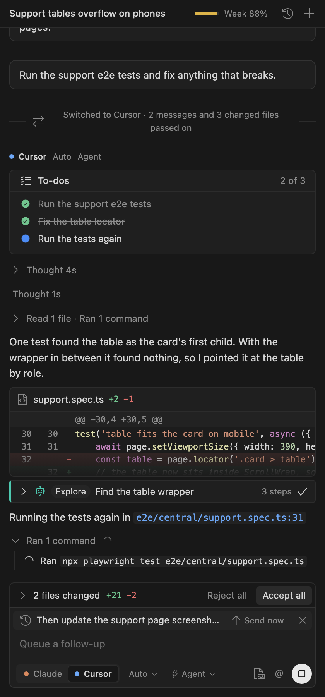
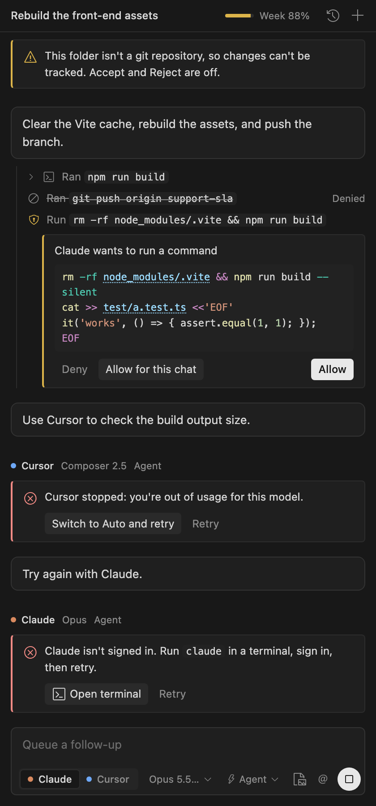
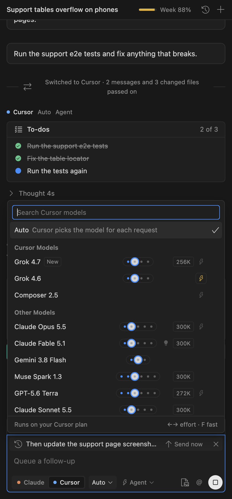
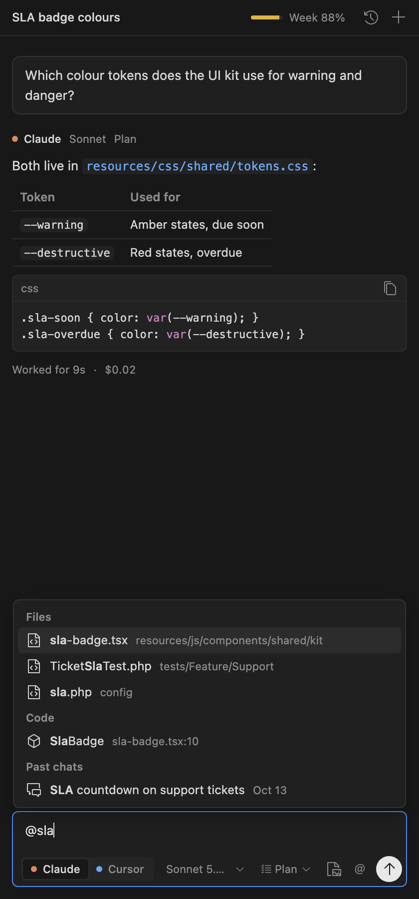
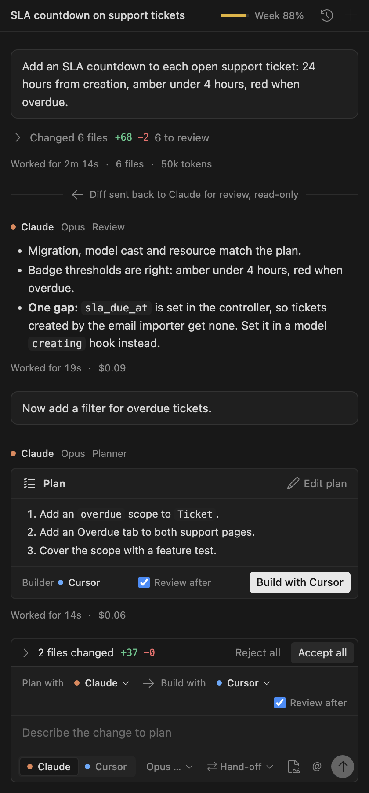
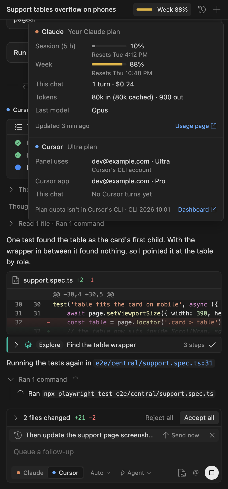
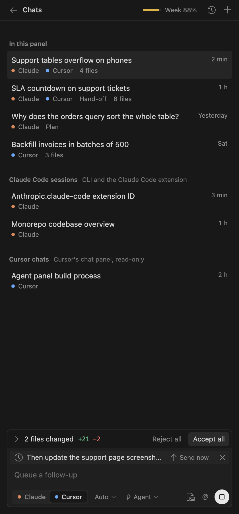
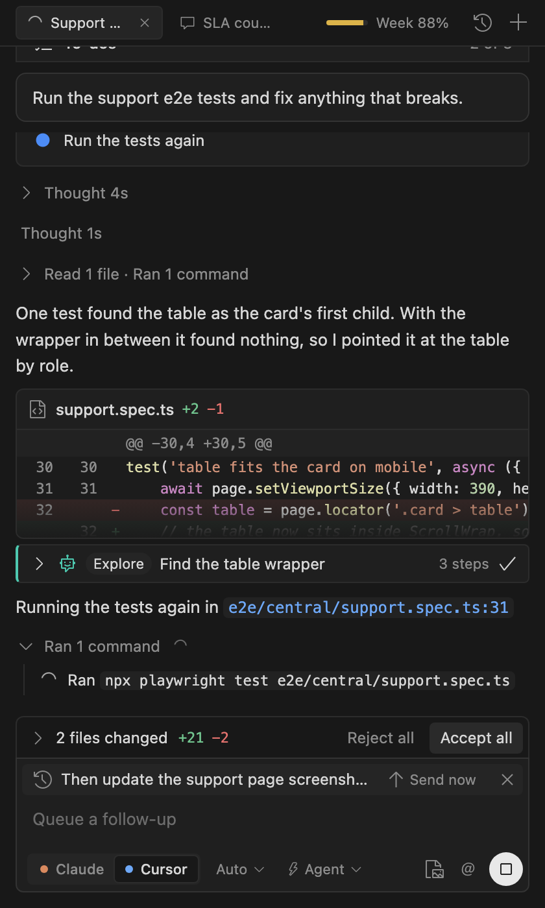
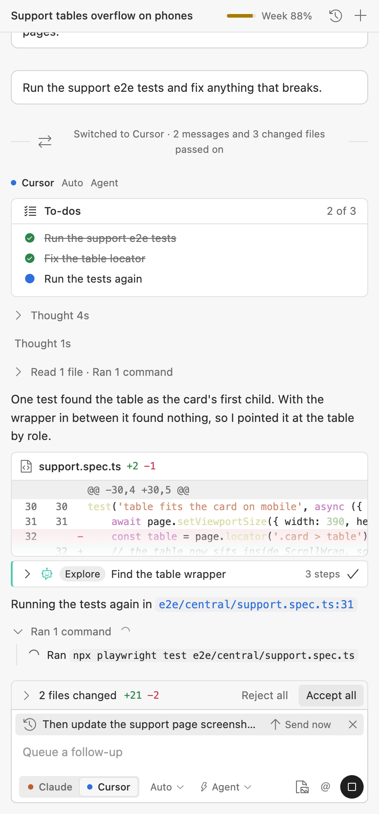
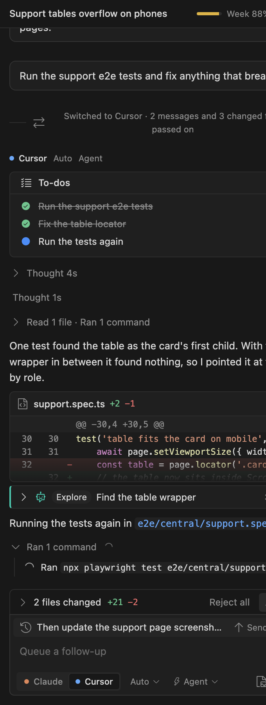

# Agent Panel

**One chat panel for VS Code and Cursor that runs your own Claude Code and Cursor Agent CLIs side by side, and lets you review every edit file by file.**

Agent Panel does not talk to any model API and never sees your credentials. It starts the command-line tools you already have, signed in the way you signed them in, and puts them in one thread with one review flow.



## Why

Coding agents ship as separate chat panels, each with its own history, its own diff review and its own idea of what "undo" means. If you use more than one, you lose context every time you switch. Agent Panel gives you:

- **Two engines, one thread.** Pick **Claude** (the Claude Code CLI) or **Cursor** (the Cursor Agent CLI) per message. Switching hands the other engine what happened so far: the conversation, what was read, run and edited, the to-do list and the diff of unreviewed changes.
- **A review flow that works the same for both.** Every turn is snapshotted with git, so each changed file gets a card with a diff, and **Accept**, **Reject** and **Undo** work per file or for everything at once.
- **Hand-off.** One engine plans read-only, you read the plan, the other engine builds it, and the planner can review the result.
- **Stays out of the way.** Plain TypeScript and CSS, no UI framework, a webview under 80 KB minified that follows your editor theme.

## Requirements

| You need | Notes |
| --- | --- |
| VS Code 1.90+ or Cursor | The panel lives in the secondary sidebar and in editor tabs. |
| A **git** repository | Review (Accept / Reject / Undo) uses git tree snapshots. Without git the panel still chats, with review turned off. |
| At least one CLI | [Claude Code](https://docs.claude.com/en/docs/claude-code) (`claude`) and/or [Cursor Agent](https://cursor.com/cli) (`agent`), installed and signed in. |
| A trusted folder | The extension refuses to run in untrusted workspaces, because agents edit files and run commands. |

Developed and tested on macOS. Linux and Windows are best effort: see [Known limits](#known-limits).

## Install

From a release `.vsix`:

```bash
code --install-extension agent-panel-<version>.vsix      # VS Code
cursor --install-extension agent-panel-<version>.vsix    # Cursor
```

Or build it yourself:

```bash
git clone <this repository> && cd agent-panel
npm install
npm run package          # writes agent-panel-<version>.vsix
```

Reload the window, then open **Agent Panel** in the secondary sidebar or run **Agent Panel: Open**.

## Quick start

1. Open a git repository.
2. Under the box, choose an engine, a model and a mode.
3. Ask for something. Steps stream in, folded; each changed file appears as a card with its diff.
4. Click **Accept** or **Reject** on a file, or use the bar above the box for everything.

## A tour

### Steps, thinking and diffs

Each turn shows what the agent did: reads, searches, commands, sub-agents and to-dos fold into one summary row you can expand. Thinking is folded too. Every changed file gets a card with `+`/`−` counts and that turn's diff, with long unchanged runs collapsed.

### Permissions and errors stay in the thread

Prompts and failures appear where they happen. No modals, no toasts.



- **Allow**, **Allow for this chat** or **Deny** on each tool request (**Ask first** mode).
- Errors say what to do: *Switch to Auto and retry*, *Open terminal* to sign in, *Retry*.
- A folder without git shows a banner and turns Accept / Reject off.

### Models, effort and speed straight from the tools



The picker shows the models the CLIs themselves report, grouped like Cursor's own picker. Each row carries its settings: an effort stepper (click a dot, drag, or use ←→), a ⚡ fast toggle and the context size where the model offers them. Claude settings change inside the running session, without a restart.

### `@` context



Type `@` for recent files, files and folders, code symbols, git (working changes, commits, this branch), problems, past chats, rules (`AGENTS.md`, `CLAUDE.md`, Cursor rules) and the editor selection. Picks become chips; click any chip to open what it points to. Paste or drop images. Select code and press **⌘⌥L** (**Ctrl+Alt+L**) to attach it.

### Hand-off: plan with one engine, build with the other



Choose **Hand-off** mode and a planner and builder. The planner runs read-only and its plan appears as a card you can edit. **Build with …** gives the builder the plan and your request. With **Review after**, the planner reads the builder's diff, read-only, and reports what is missing.

### Usage and chats

<p>


</p>

The header meter shows Claude's weekly usage. Click it for both engines: Claude's 5-hour and weekly windows with reset times, cost and tokens for the chat; Cursor's plan, account and tokens for the chat. History lists this panel's chats, your Claude Code sessions (continued under the same id) and your Cursor chats (read-only).

### A fixed space, with chat tabs



Agent Panel is listed in the activity bar like any other view (Explorer, Search, Run and Debug, ...). Choosing it opens the chat in the secondary sidebar, in a space of its own, and nothing else opens there. Each chat is a tab in the header (a spinner marks one that is running); the history and **+** buttons sit beside the tabs. Prefer editor tabs? Set `agentPanel.chatLocation` to `editor`; chats then share one locked editor group that no file or diff ever opens in.

### Light themes and narrow widths

<p>


</p>

Colours come only from your editor theme. The layout is checked at 340 px.

## Features

| Area | What you get |
| --- | --- |
| **Engines** | Claude Code CLI and Cursor Agent CLI, per message, in one thread. Each keeps its own session; switching passes a hand-over. |
| **Modes** | **Agent** (edits files), **Ask first** (approve each edit or command), **Plan** (read-only), **Hand-off** (plan, build, review), **Auto** (no prompts; see [Safety](#safety)). |
| **Review** | Per-file Accept, Reject and Undo; Accept all / Reject all; **Restore checkpoint** on any message; in-editor highlights; next/previous change and file; a **Review** view. |
| **Turn control** | Stop with **⌘.**, queued follow-ups (send now, remove), retry, edit and resend, a context meter with compact. |
| **Chats** | Chats are tabs in the Agent Panel sidebar (its own fixed space, like Cursor's chat; the Review list lives in the Explorer instead) and keep running while you switch tabs; saved per workspace; tabs return after a reload. |
| **Context** | `@` mentions, images, slash commands and skills (Claude and Cursor), rules files. |
| **Models** | Catalogs read from the tools themselves, with effort, fast mode and context size. |
| **Usage** | Claude 5-hour and weekly windows; Cursor plan and account; tokens and cost per turn and per chat. |

### Review shortcuts

When files are pending and an editor is focused:

| Keys | Action |
| --- | --- |
| **Alt+F5** / **Shift+Alt+F5** | Next / previous change |
| **Alt+F6** / **Shift+Alt+F6** | Next / previous edited file |
| **Alt+Enter** | Accept the file (only when the focused editor is a pending file) |
| **Alt+Backspace** | Reject the file (only when the focused editor is a pending file; asks first) |

## How it works

```
 webview (plain TS)  <── messages ──>  extension host  ──spawns──>  claude  (one long-lived process per chat)
   thread, composer,                     turns, queue,              agent   (one process per turn)
   file cards, pickers                   permissions, history
                                              │
                                              └── git tree snapshots before and after every turn ──> per-file diffs,
                                                  Accept / Reject / Undo, Restore checkpoint
```

- **Engines** emit one common event stream (text, thinking, tool steps, permission requests, usage, done), so the UI and review code never branch on the engine.
- **Change tracking** copies `.git/index` to a temp file and runs `git add -A` plus `git write-tree` against it. Your index, stash, HEAD and branches are never touched. Reject writes back the file from the turn's base tree, and deletes it only when git confirms the base had no such file.
- **Switching engines** builds a hand-over from the thread record: messages, steps, to-dos and the unreviewed diff, capped in size.

More detail in [docs/ARCHITECTURE.md](docs/ARCHITECTURE.md).

## Settings

| Setting | Default | Meaning |
| --- | --- | --- |
| `agentPanel.claudePath` | empty | Path to the Claude Code CLI. Empty: the one bundled with the Claude Code extension, else `claude` on your `PATH`. |
| `agentPanel.cursorPath` | empty | Path to Cursor's `agent` CLI. Empty: `~/.local/bin/agent`, else `agent` on your `PATH`. |
| `agentPanel.chatLocation` | `sidebar` | `sidebar`: chats are tabs inside the Agent Panel secondary sidebar, a fixed space of their own like Cursor's chat. `editor`: each chat is an editor tab, all in one locked editor group that nothing else opens in. |
| `agentPanel.openEditsInEditor` | `false` | Open the first changed file with its highlights when a turn finishes. |

Both paths are machine-scoped, so a repository's `.vscode/settings.json` cannot point the extension at a program. Reload the window after changing them. **Agent Panel: Show Log** shows turns, errors and timings.

## Safety

Agents edit files and run commands. Treat Agent Panel as a front end for tools that can do both.

- **No credentials.** The panel never reads or stores them. It starts the CLIs you are signed into.
- **Trusted folders only.** The extension is disabled in untrusted workspaces.
- **Pick the mode on purpose.** **Agent** auto-approves edits (and runs Claude with `acceptEdits`); **Ask first** prompts for every edit and command; **Plan** is read-only. **Auto** runs Claude with permissions bypassed and Cursor with `--force`: use it only in folders and repositories you trust.
- **Review is not a sandbox.** Accept / Reject undo file edits. They cannot undo commands the agent ran (network calls, installs, `git push`).
- **Untrusted content.** File contents and web pages an agent reads can contain instructions aimed at the agent (prompt injection). Prefer **Ask first** when working with code you did not write.
- The webview uses a strict content security policy, escapes everything it renders, and only opens `https:` links and workspace-relative paths.

To report a vulnerability, see [SECURITY.md](SECURITY.md).

## Known limits

- Edits you make by hand during a turn show up in that turn's diff.
- Accept, Reject and Undo state is in memory: after a reload, older file cards keep their diffs but lose their buttons. **Restore checkpoint** still works.
- Cursor's CLI has no plan-quota command; the panel shows tokens per turn and links to the Cursor dashboard.
- Claude's usage windows update after each Claude turn (the CLI reports them per request).
- Cursor's own chats are read-only in the panel. Continuing one starts a CLI chat with the history passed along.
- Cursor turns run as whichever account the CLI is signed into, which can differ from the Cursor app's. The usage panel shows both.
- Don't continue the same Claude session in this panel and the Claude Code extension at the same moment.
- Only one turn runs at a time across tabs; messages sent meanwhile wait in that tab's queue.
- The workspace folder must be the git repository root. Multi-root workspaces use the first folder.
- Reading Cursor's model catalog, account and chat history uses Cursor's local data on macOS (`~/Library/Application Support/Cursor`) and the `sqlite3` tool. On Linux and Windows those lists fall back to a built-in set; turns still run.

## Develop

```bash
npm install
npm test          # builds, then runs the node:test suites (parsers, models, markdown, change tracking, review)
npm run watch     # rebuild on change
npm run package   # release build and .vsix
```

Press **F5** in VS Code with this folder open to launch an Extension Development Host.

`qa/harness.html` runs the built webview against a fake host so you can check any state in a browser, no editor needed:

```
qa/harness.html#agent-turn            # also: handoff, states, empty, pickers
qa/harness.html#agent-turn&theme=light&w=340
qa/harness.html#agent-turn&click=.ap-usage          # click selectors (join with ~) to open a menu
```

The screenshots in this README come from that harness. `prototype/` holds the original static design spec, one page per state.

## Contributing

Issues and pull requests are welcome. Read [CONTRIBUTING.md](CONTRIBUTING.md) first. Release notes are in [CHANGELOG.md](CHANGELOG.md).

## Trademarks

Agent Panel is an independent project. It is not affiliated with, endorsed by or sponsored by Anthropic or Anysphere (Cursor). "Claude" and "Claude Code" are trademarks of Anthropic; "Cursor" is a trademark of Anysphere. The panel only launches those products' CLIs on your machine.

## License

[MIT](LICENSE). Icons are [Codicons](https://github.com/microsoft/vscode-codicons) (CC BY 4.0, code MIT).
